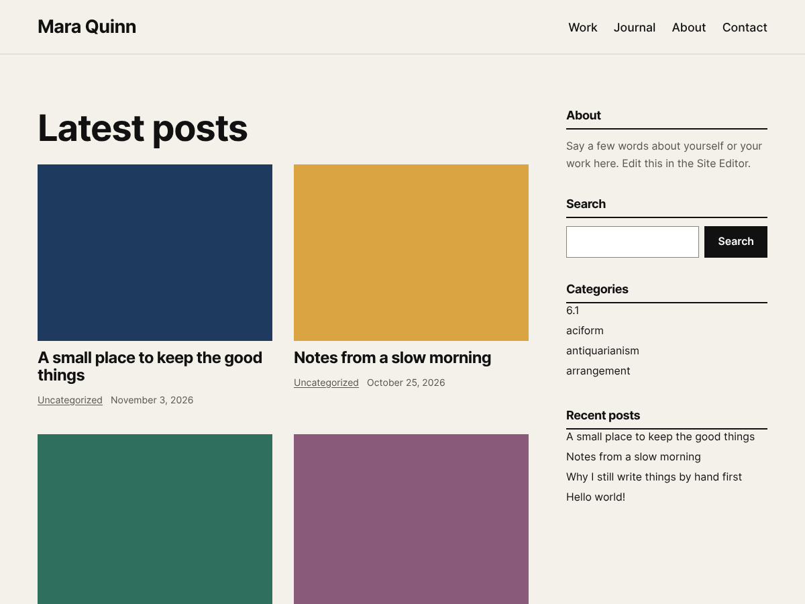

# Cairn

A block theme that puts your work first: a two-column grid of featured images beside a simple sidebar.



## Features

- **Block theme.** Built with `theme.json`, HTML block templates and template parts. Colors, typography, spacing and layout are editable in the Site Editor (Appearance > Editor > Styles).
- **Two columns.** Posts on the left, an editable sidebar on the right. The sidebar drops below the posts on small screens.
- **Image grid.** Posts show as a two-column grid of 4:3 featured images with the title, categories and date underneath.
- **Sidebar template part.** About, Search, Categories and Recent posts by default; add or remove blocks in the Site Editor.
- **Bundled font.** Inter (variable), served from the theme. Nothing is loaded from other websites.
- **Styled comments** with cards, round avatars, a threaded reply line and a restyled comment form.
- **Accessible by default.** Visible keyboard focus styles, text contrast of at least 4.5:1, and a skip link added by WordPress.
- **Translation ready** with the `cairn` text domain (translations load through WordPress.org).
- **No build step and no dependencies.**

### Templates

| Template | Used for |
| --- | --- |
| `index` | Blog home and fallback |
| `single` | Single posts, with comments and the sidebar |
| `page` | Pages (single column, no sidebar) |
| `archive` | Category, tag, author and date archives |
| `search` | Search results |
| `404` | Not found |

Header, footer and sidebar are template parts.

## Requirements

- WordPress 6.6 or later
- PHP 7.4 or later

## Installation

1. Download the theme zip from the latest release, or copy the `cairn` folder to `wp-content/themes/`.
2. In WordPress, go to **Appearance > Themes** and activate **Cairn**.
3. Open **Appearance > Editor** to adjust the header, sidebar, menu and styles.

## Project structure

```
cairn/
├── style.css          Theme header and the few styles theme.json can't express
├── theme.json         Settings, palette, typography, layout and block styles
├── functions.php      Theme support, image size and stylesheet
├── templates/         Block templates (index, single, page, archive, search, 404)
├── parts/             Template parts (header, footer, sidebar)
├── assets/fonts/      Inter (woff2) with its license
├── screenshot.png     1200 x 900 theme screenshot
├── readme.txt         WordPress.org readme
└── changelog.md
```

## Development

There is no build step. Edit the files and reload your test site.

- Work on branches and open pull requests against `develop`.
- Check block templates after editing: every `<!-- wp:... -->` needs a matching closing comment.
- Before a release, run the [Theme Check](https://wordpress.org/plugins/theme-check/) plugin and the [Theme Unit Test](https://github.com/WordPress/theme-test-data) data on a test site.
- To release, bump `Version` in `style.css`, `Stable tag` in `readme.txt` and add a section to `changelog.md`, then open a pull request from a branch named `release/1.0.1` (matching the version) into `develop`. Merging it tags `1.0.1`, publishes the release with the changelog notes and attaches `cairn.1.0.1.zip`.

## Credits and licenses

- Cairn is licensed under the [GNU General Public License v2 or later](https://www.gnu.org/licenses/gpl-2.0.html). (C) 2026 Benjamin Lu.
- [Inter](https://github.com/rsms/inter), (C) 2020 The Inter Project Authors, [SIL Open Font License 1.1](assets/fonts/OFL-Inter.txt).
- `screenshot.png` was created by the theme author for this theme.
